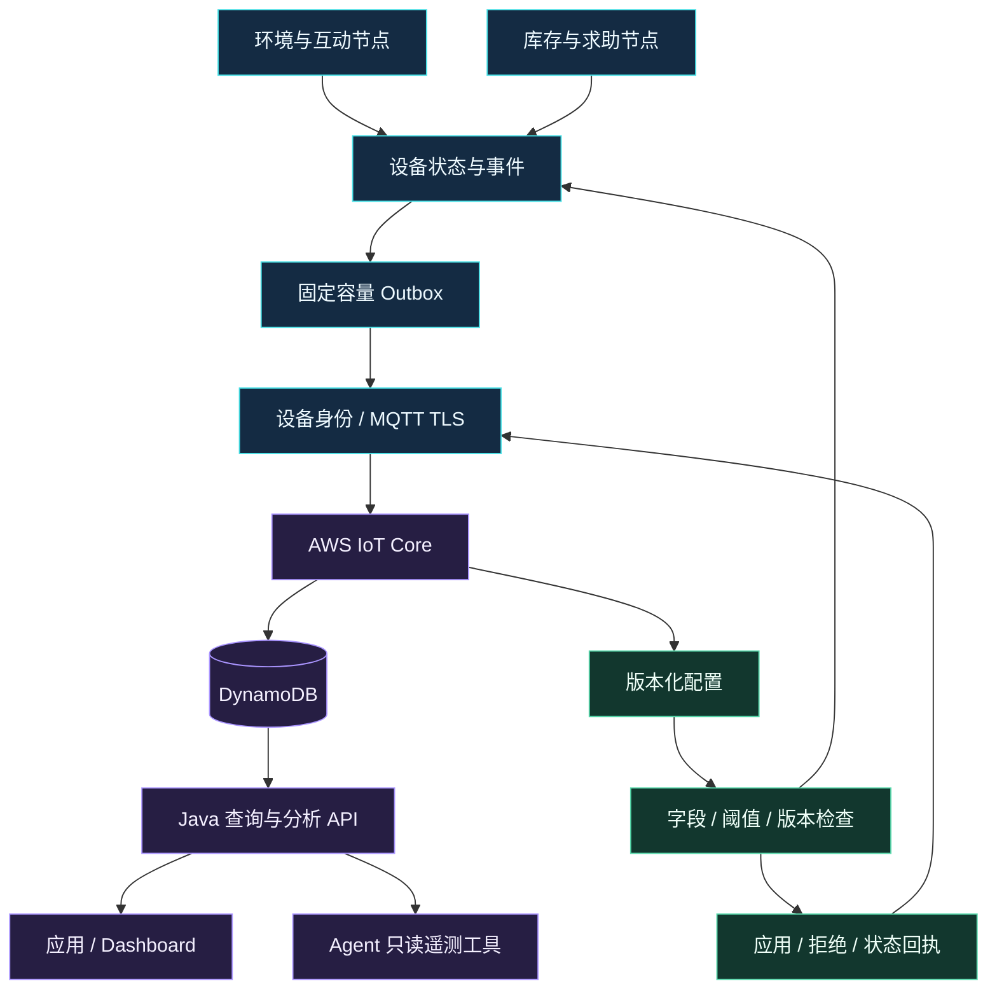
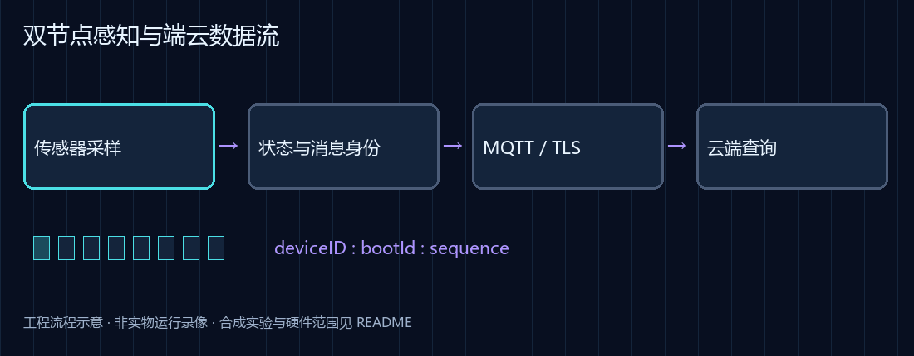
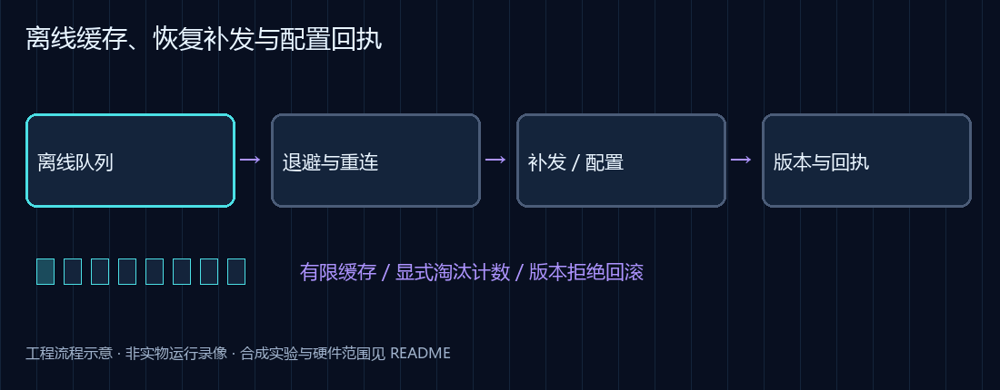

# AIoT 智能货架与端云通信系统

**C++17 · Arduino MKR WiFi 1010 · MQTT / TLS · AWS IoT · DynamoDB · Java 17**

[个人技术作品集](https://github.com/KristenYue) · [工业 Agent 应用](https://github.com/KristenYue/telecom-network-incident-agent) · [遥测协议](docs/TELEMETRY_V2.md)

双节点分别完成环境与库存感知，将传感器输入转为设备状态、现场告警和遥测；通过 MQTT/TLS 接入云端，提供数据存储、查询分析与配置管理能力。

项目重点解决：**设备重启后的消息身份、离线时的有限缓存、断线重连、重复与乱序数据处理，以及远程配置版本一致性。**

---

## 本项目在研发证据链中的位置

```text
传感器与设备状态
  → 固件状态逻辑
  → 有限缓存与通信恢复
  → 云端数据处理
  → 查询 API
  → 上层应用与 Agent
```

| 关注方向 | 建议重点阅读 | 可以核查的能力 |
|---|---|---|
| **机器人 / 智能设备应用** | 状态机、传感器节点、遥测与设备查询 | 设备状态抽象、事件优先级、接口接入 |
| **工业软件 / 半导体设备应用** | 消息身份、配置版本、状态查询 | 遥测一致性、设备配置、告警与应用接口 |
| **智能汽车 / 端云平台** | 离线缓存、重连退避、重复与乱序处理 | 连接恢复、有限资源、会话身份与数据消费 |
| **物联网后端** | 遥测协议、云端存储、Java API | 设备隔离、数据契约、查询与状态服务 |

上述方向复用的是软件设计方法；当前业务实现为双节点智能货架。

---

## 核心结果一览

| 研发成果 | 实际结果 | 原始证据 |
|---|---|---|
| **双节点协议处理** | **50,000 条合成遥测**，四类处理计数完整闭合 | [实验报告](iot-test-harness/docs/TEST_REPORT.md) |
| **有效数据持久化** | **48,512 条**正常入库，数量与 accepted 计数一致 | [原始报告](iot-test-harness/docs/TEST_REPORT.md) |
| **异常消息分类** | **1,012 条重复、13 条乱序、463 条身份冲突**被拦截 | [分类结果](iot-test-harness/docs/TEST_REPORT.md) |
| **离线资源约束** | 固定容量 `FixedOutbox<4,96,512>`；同型对象在 Windows x64 ABI 下为 **2,496 字节** | [固件验证](docs/FIRMWARE_VALIDATION.md) |
| **连接恢复调度** | **1 / 2 / 4 / 8 / 16 / 30 秒**退避，成功后重置 | [重连实现](firmware/core/include/smart_shelf/reconnect_backoff.hpp) |
| **配置一致性** | 高版本且参数合法才提交；重复、旧版本及非法配置拒绝 | [配置实现](firmware/core/include/smart_shelf/config_version.hpp) |

50,000 条结果来自固定种子的合成协议实验，不作为真实硬件采样量或 AWS 生产吞吐。宿主机对象尺寸与目标板 SRAM 分别记录。

---

## 业务场景与节点分工

| 节点 | 输入 | 本地处理 | 云端用途 |
|---|---|---|---|
| **环境与互动节点** | 温度、湿度、气压、超声波、光线 | 环境持续异常判断、靠近与互动事件 | 环境趋势、互动统计、设备状态 |
| **库存与求助节点** | 重量、光线、声音、求助按钮 | 库存状态、遮挡与碰撞异常、人工求助 | 库存告警、事件查询、应用诊断 |
| **配置通道** | MQTT `/config` | 校验版本、字段与阈值关系，提交或拒绝 | 当前配置版本与应用回执 |

库存节点优先级：

```text
人工求助 → 遮挡异常 → 声音异常 → 无库存 → 低库存 → 正常
```

---

## 系统架构



硬件访问保留在 `.ino` 适配层；状态、队列、重连与配置逻辑位于 `firmware/core/`，支持宿主机编译与独立检查。

---

## 场景一：双节点遥测到云端应用



> 工程流程示意动画，非实物运行录像。合成实验、固件核心与实际设备验证分别记录。

### 问题：同一个设备 ID 不足以识别消息

设备重启后序号可能重新开始，网络也可能造成重复投递或乱序。仅凭设备 ID 或接收顺序，无法区分新消息、旧会话及冲突载荷。

### 设计：消息身份、会话与时间分离

每条遥测使用：

```text
messageId = deviceID : bootId : sequence
```

| 字段 | 责任 |
|---|---|
| `deviceID` | 区分设备 |
| `bootId` | 区分重启会话 |
| `sequence` | 表达同一会话内顺序 |
| `timeSynchronized` | 标明设备时间是否可信 |
| `receivedAt` | 保存云端接收时间 |

相同身份再次到达时，进一步区分相同载荷与冲突载荷。采样时间与接收时间承担不同语义，未校时数据不能直接覆盖可信时间状态。

[Telemetry v2](docs/TELEMETRY_V2.md)

### 量化实验

环境：Windows / Python 3.12.9，固定种子 `20261102`。

| 分类 | 条数 | 处理 |
|---|---:|---|
| 正常数据 | **48,512** | 持久化 |
| 重复消息 | **1,012** | 拦截重复 |
| 会话内乱序 | **13** | 按顺序契约拒绝 |
| 同身份载荷冲突 | **463** | 显式冲突分类 |
| **总计** | **50,000** | 分类计数与持久化结果核对 |

实验验证的是设备隔离、消息身份与持久化契约。脚本处理速度不等同于 MQTT 网络吞吐或真实云端容量。

[完整实验与数据口径](iot-test-harness/docs/TEST_REPORT.md)

### 与 Agent 应用连接

云端查询接口：

```http
GET /api/shelves/{deviceId}/telemetry?limit=1
```

上层 Adapter 校验设备身份、来源、状态与时间新鲜度：

- 当前有效遥测作为设备观测。
- 低库存状态可关联对应知识条目。
- 过期遥测返回 `TELEMETRY_STALE`。
- 不将历史状态解释为当前设备故障。

[Agent 适配源码](https://github.com/KristenYue/telecom-network-incident-agent/blob/main/src/telecom_incident_agent/shelf_adapter.py)

---

## 场景二：断网恢复与远程配置



> 动画展示通信与配置机制。实物弱网表现需要结合设备日志单独验证。

### 设计一：有限缓存与显式数据取舍

断网时使用固定容量 Outbox 保存待发送消息。

```text
采样与状态判断
  → 生成遥测
  → 尝试发送
  → 离线时入队
  → 恢复后按 FIFO 补发
```

| 边界情况 | 处理方式 |
|---|---|
| 队列达到容量 | 淘汰最旧项并记录计数 |
| 消息超过允许长度 | 拒绝，保持已有数据完整性 |
| 队列回绕 | 保持 FIFO 顺序 |
| 网络持续不可用 | 缓存容量保持有界 |

采用 `FixedOutbox<4,96,512>`，队列核心使用固定存储。Windows x64 同型对象尺寸为 **2,496 字节**；目标板资源消耗以目标编译报告为准。

[固定队列源码](firmware/core/include/smart_shelf/fixed_outbox.hpp)

### 设计二：联网尝试与本地处理分开调度

此前联网调用内重复尝试与等待时钟会长期占用采样循环。调整为每轮至多一次连接尝试，本地采样与遥测处理放在本轮联网操作之前。

失败后按以下间隔退避：

```text
1 → 2 → 4 → 8 → 16 → 30 秒
```

- 退避从尝试结束时开始计时。
- 成功连接后重置。
- TLS 握手前检查网络时钟。
- 计时采用差值处理，覆盖 32 位回绕边界。

WiFiNINA、TLS 和 MQTT 库的单次调用仍可能阻塞；该设计约束重试调度，不将其表述为完整实时系统。

[重连实现](firmware/core/include/smart_shelf/reconnect_backoff.hpp) · [设计与验证](docs/FIRMWARE_VALIDATION.md)

### 设计三：配置版本与应用回执

远程配置通过现有 `/config` 通道下发：

```text
接收配置
  → 检查版本
  → 校验字段与阈值关系
  → 原子提交
  → 返回当前版本与应用结果
```

| 情况 | 处理 |
|---|---|
| 更高版本且参数合法 | 应用并返回 `configuration_updated` |
| 重复或旧版本 | 拒绝并返回 `configuration_rejected` |
| 字段或阈值非法 | 保留原配置 |
| 查询当前配置 | 返回 `configuration_status` |

版本随当前会话保存在 RAM，重启后恢复默认配置与版本 0。此边界与云端持久化配置分别考虑。

[版本与校验源码](firmware/core/include/smart_shelf/config_version.hpp)

---

## 核心模块与源码

| 模块 | 研发职责 | 入口 |
|---|---|---|
| **设备状态机** | 库存、告警与事件优先级 | [shelf2_controller.hpp](firmware/core/include/smart_shelf/shelf2_controller.hpp) |
| **固定队列** | 有限缓存、FIFO、淘汰与长度边界 | [fixed_outbox.hpp](firmware/core/include/smart_shelf/fixed_outbox.hpp) |
| **连接调度** | 指数退避、重置与计时回绕 | [reconnect_backoff.hpp](firmware/core/include/smart_shelf/reconnect_backoff.hpp) |
| **配置管理** | 版本、参数检查与提交 | [config_version.hpp](firmware/core/include/smart_shelf/config_version.hpp) |
| **固件适配** | 传感器、网络与设备入口 | [firmware](firmware) |
| **云端服务** | 数据查询、分析与设备接口 | [cloud-service](cloud-service) |
| **告警扩展** | 告警持久化与查询 | [spring-alert-service](spring-alert-service) |
| **协议验证** | 设备隔离、重复、乱序与批量数据核对 | [iot-test-harness](iot-test-harness) |

---

## 运行方法

### 固件核心

在仓库根目录执行：

```powershell
.\scripts\build_firmware_core.cmd
```

### 遥测与一致性实验

```bash
cd iot-test-harness

python -m pip install -e '.[test]'
python -m pytest
python tools/run_stability.py --messages 50000
```

### Java 云端服务

```bash
cd cloud-service
mvn --batch-mode verify
```

部署时通过本机环境配置 AWS 区域、凭据、IoT 数据端点及 API Token。

### 目标板与设备身份

固件目标为 Arduino MKR WiFi 1010。各节点使用独立设备身份；配置与依赖见固件目录及 [构建流程](.github/workflows/ci.yml)。

从 `secrets.example.h` 创建本地 `secrets.h`。私钥、证书、Token 和本机配置不进入公开仓库。

---

## 工程复盘与 Bad Case

| 问题 | 设计处理 |
|---|---|
| 重启后序列从头开始 | `bootId` 区分新旧会话 |
| 重复消息再次入库 | 消息身份与载荷一致性检查 |
| 旧配置晚到覆盖新配置 | 单调版本与拒绝回执 |
| 离线时间过长导致缓存增长 | 固定容量、明确淘汰策略与计数 |
| 计时器回绕导致提前重连 | 使用差值计时并验证边界 |
| 未校时消息覆盖可信时间 | 时间同步标记与云端接收时间分离 |
| 发送成功被误认为业务完成 | 区分 MQTT 传输结果与云端业务处理结果 |

[工程日志](docs/ENGINEERING_LOG.md) · [Bad Case](docs/BAD_CASES.md) · [固件范围](docs/FIRMWARE_VALIDATION.md)

---

<details>
<summary>验证环境与结果口径</summary>

50,000 条消息为合成协议实验，不是线上硬件采样。宿主机状态与队列验证、目标板编译、实际设备弱网与云端在线联调分别记录。

2,496 字节为 Windows x64 ABI 下同型 Outbox 对象尺寸，不作为 Arduino SRAM 使用量。

MQTT QoS 1 与业务入库成功是不同环节；当前出队依据发送接口结果，未提供独立端云业务 ACK。

Agent 适配回归使用合成云端响应，不将其表述为持续在线的 AWS 真机联调。

</details>

---

[MIT License](LICENSE)
