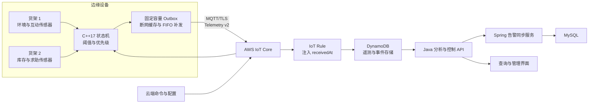

# AIoT 智能货架与端云可靠性系统

[](https://github.com/KristenYue/smart-supermarket-shelf/actions/workflows/ci.yml)


面向智能零售场景构建的双节点 AIoT 系统，覆盖**传感器采集、边缘状态判定、离线消息缓存、MQTT/TLS 通信、云端存储分析和自动化可靠性验证**。

项目重点解决的不是“如何把传感器数据上传到云端”，而是：

> 当设备断网、重启、未完成网络校时，或者消息发生重复、乱序和冲突时，如何保证边缘设备仍能响应现场事件，并让端云数据保持可识别、可追踪和可验证。

---

## 10 秒了解项目

```text
货架节点 1                         货架节点 2
环境与顾客互动                    库存与人工求助
温湿度/气压/距离/光线             重量/声音/光线/按钮
       │                                │
       └──────── C++17 边缘状态机 ─────┘
                        │
               固定容量离线 Outbox
                        │
          ATECC608A 设备身份 + MQTT/TLS
                        │
                   AWS IoT Core
                        │
              IoT Rule + DynamoDB
                        │
          Java 分析服务 / Spring 告警服务
                        │
            查询接口、告警同步与控制
```

| 核心结果 | 当前数据 |
|---|---:|
| Python 自动化测试 | **79 项通过，0 项失败** |
| Python 测试覆盖率 | **96.17%** |
| 稳定性实验输入 | **50,000 条双设备遥测** |
| 数据完整性校验 | **通过** |
| 本地协议处理吞吐量 | **63,919.3 条/秒** |
| 工程 Bad Case | **10 项闭环记录** |
| CI 验证层次 | **C++、Python、Java、Spring 四层** |

> 吞吐量来自固定环境下的 Python 内存网关协议处理实验，用于验证契约、去重、排序和数据完整性，不等同于公网 MQTT 或 AWS IoT 的端到端吞吐量。

---

# 实际应用场景

系统将智能货架拆分为两个职责不同的边缘节点。

## 货架节点 1：环境与顾客互动

`smart-shelf-01` 负责采集：

- 温度
- 湿度
- 气压
- 顾客距离
- 环境光线
- 顾客靠近与商品互动

当环境持续越界时，设备能够在边缘完成状态判断并触发现场告警。

## 货架节点 2：库存与人工求助

`smart-shelf-02` 负责采集：

- 商品重量
- 环境声音
- 环境光线
- 人工求助按钮
- 称重模块健康状态

当多个传感器同时异常时，系统按照显式优先级决定最终状态：

```text
人工求助
  > 遮挡异常
  > 声音异常
  > 无库存
  > 低库存
  > 正常
```

这种设计避免最终状态由多个 `if` 语句的偶然排列顺序决定。

---

# 系统架构



## 技术分层

| 层次 | 主要技术 | 工程职责 |
|---|---|---|
| 设备与传感器 | Arduino MKR WiFi 1010、MKR ENV、HX711 | 采集环境、库存和交互信号 |
| 边缘控制 | C++17、状态机、固定容量容器 | 状态判定、现场告警、离线缓存 |
| 设备安全 | ATECC608A、BearSSL、TLS | 保存设备私钥并建立安全连接 |
| 消息通信 | MQTT、Telemetry v2 | 遥测、事件、告警、命令和配置 |
| 云端链路 | AWS IoT Core、IoT Rule、DynamoDB | 消息接收、服务端时间和数据持久化 |
| 后端服务 | Java 17、Javalin、Spring Boot、MySQL | 数据分析、告警同步、设备控制和查询 |
| 自动化验证 | CTest、pytest、Maven、GitHub Actions | 契约、故障、数据一致性和持续集成 |

---

# 三个核心工程设计

## 1. 断网不停止业务：固定容量离线 Outbox

### 问题

早期实现将设备业务循环与 Wi-Fi/MQTT 连接状态绑定：

```text
网络不可用
    ↓
连接函数提前返回
    ↓
传感器采样停止
    ↓
状态机不再运行
    ↓
断网期间现场状态丢失
```

对于边缘设备来说，云端不可用不应该导致本地感知和现场执行停止。

### 解决方案

项目将通信连接与设备业务循环解耦：

```text
传感器持续采样
    ↓
边缘状态机持续运行
    ↓
现场 LED/蜂鸣器继续响应
    ↓
消息发送失败时进入 Outbox
    ↓
网络恢复后按 FIFO 顺序补发
```

两套设备固件共用：

```cpp
FixedOutbox<4, 96, 512>
```

分别表示：

- 最多缓存 4 条消息；
- Topic 最大长度 96 字节；
- Payload 最大长度 512 字节。

### 设计特点

- 编译期确定内存上界；
- 不使用动态内存，降低长期运行中的堆碎片风险；
- MQTT 发送失败时将消息加入队列；
- 网络恢复后按照 FIFO 顺序发送；
- 队列满时淘汰最旧消息并记录丢弃计数；
- 超长 Topic 或 Payload 会被明确拒绝；
- 设备断网期间仍然执行采样与状态判断。

---

## 2. 重启、乱序与重复消息：Telemetry v2

### 问题

仅使用 `deviceID + timestamp` 标识消息存在多个风险：

- 设备启动早期可能尚未完成网络校时，连续消息的时间戳均为 `0`；
- 网络时间可能发生回拨或跳变；
- MQTT QoS 1 允许消息重复投递；
- 网络恢复后离线消息可能乱序到达；
- 设备重启后序列号重新从 1 开始；
- 同一消息身份可能出现不同载荷。

### 解决方案

Telemetry v2 使用以下消息身份：

```text
messageId = deviceID : bootId : sequence
```

其中：

| 字段 | 作用 |
|---|---|
| `deviceID` | 标识消息所属设备 |
| `bootId` | 区分不同设备启动会话 |
| `sequence` | 表示同一次启动中的消息顺序 |
| `messageId` | 形成可追踪的唯一消息身份 |
| `timestamp` | 表示设备侧业务时间 |
| `timeSynchronized` | 标识设备时间是否可信 |
| `receivedAt` | AWS IoT Rule 注入的服务端接收时间 |

### 网关处理规则

```text
新消息
  │
  ├── 身份和载荷均未出现
  │       └── accepted
  │
  ├── 身份和载荷完全相同
  │       └── duplicate
  │
  ├── 身份相同但载荷不同
  │       └── payload_conflict
  │
  ├── 同一 bootId 内序号小于当前窗口
  │       └── out_of_order
  │
  └── 新 bootId
          └── 建立新顺序窗口，允许 sequence 从 1 开始
```

### 设计效果

- 消息顺序不依赖设备墙上时钟；
- 未校时时允许显式发送 `timestamp=0`；
- 设备重启后不会把合法新消息误判为旧数据；
- 重复消息不会重复写入；
- 相同身份但不同载荷的消息会被识别为冲突；
- DynamoDB 使用服务端 `receivedAt` 排序，避免未校时消息发生主键覆盖。

完整协议见 [Telemetry v2](docs/TELEMETRY_V2.md)。

---

## 3. 设备身份、远程命令与配置安全

### 设备身份

每台设备拥有独立的：

- AWS IoT Thing
- Client ID
- 设备证书
- ATECC608A 私钥
- MQTT Topic 权限

CloudFormation 使用 Thing Policy Variable，将证书、Client ID、Thing Name 和 Topic 权限绑定到同一个设备身份。

设备只能：

- 发布自身遥测、事件和告警；
- 订阅自身命令与配置；
- 访问被明确授权的 Topic。

### 远程命令

支持的设备命令包括：

```text
ON
OFF
FLASH
AUTO
ACK
```

Python 契约层会拒绝：

- 未知设备；
- 跨设备 Topic；
- 未声明命令；
- 含控制字符的输入；
- 越权的告警确认请求。

### 配置原子更新

远程阈值不采用逐字段直接写入，而是：

```text
复制当前配置
    ↓
在候选对象中解析全部字段
    ↓
验证类型、上下界和字段关系
    ↓
全部合法后一次性提交
```

如果任一字段非法，整个配置请求都会被拒绝，运行中的原配置保持不变，并生成 `config_rejected` 审计事件。

这样避免出现“接口返回失败，但部分设备参数已经修改”的半更新状态。

---

# 50,000 条消息稳定性实验

稳定性脚本使用固定随机种子：

```text
20261102
```

在双设备遥测流中确定性注入：

- 重复消息；
- 会话内乱序消息；
- 相同身份但不同载荷的冲突消息。

## 实验结果

| 指标 | 结果 |
|---|---:|
| 输入消息 | **50,000** |
| 正常持久化 | **48,512** |
| 重复消息拦截 | **1,012** |
| 乱序消息拦截 | **13** |
| 身份载荷冲突拦截 | **463** |
| 分类结果总数 | **50,000** |
| 数据完整性校验 | **通过** |
| 执行耗时 | **0.7822 秒** |
| 本地协议处理吞吐量 | **63,919.3 条/秒** |

结果满足：

```text
48,512 + 1,012 + 13 + 463 = 50,000
```

并且：

```text
网关实际持久化数量 = accepted 计数
```

说明异常消息未进入正常记录，所有输入均获得明确分类。

完整结果见 [AIoT 自动化测试报告](iot-test-harness/docs/TEST_REPORT.md)。

---

# 自动化测试体系

项目将边缘、协议和云端验证拆分为四层 CI。

| 验证层 | 技术 | 覆盖内容 |
|---|---|---|
| 固件核心 | C++17、CMake、CTest | 状态优先级、阈值边界、Outbox FIFO、溢出与超长帧 |
| IoT 协议 | Python、pytest | 遥测契约、命令白名单、配置安全、重启、乱序与幂等 |
| 云端分析 | Java 17、Maven | 环境与库存分析、消息来源追踪、启动会话排序 |
| 告警服务 | Spring Boot、Maven | 告警同步、设备隔离、接口参数和 JDBC 存储 |

Python 自动化测试覆盖：

- 设备身份与遥测 JSON 契约；
- 温湿度、气压、距离、光线、声音和重量边界；
- MQTT 命令 Topic 与跨设备隔离；
- 命令和远程配置白名单；
- 重复消息、乱序消息和载荷冲突；
- 设备重启后的序列恢复；
- 未同步时钟与网络时间恢复；
- 断线重连指数退避；
- 两台设备并行上报时的状态隔离；
- 批量消息稳定性与数据完整性。

测试计划见 [AIoT 自动化测试计划](iot-test-harness/docs/TEST_PLAN.md)。

---

# 快速运行

不连接 Arduino 或 AWS 账号，也可以在本地运行固件核心、协议和服务测试。

## 1. C++17 固件核心

### Windows

```powershell
.\scripts\build_firmware_core.cmd
```

### Linux

```bash
cmake -S . -B build -DCMAKE_BUILD_TYPE=Release
cmake --build build
ctest --test-dir build --output-on-failure
```

该测试验证：

- 多传感器状态优先级；
- 阈值边界；
- 固定容量队列 FIFO；
- 队列溢出策略；
- 超长帧拒绝。

## 2. Python AIoT 验证工具

```powershell
cd iot-test-harness

python -m venv .venv
.\.venv\Scripts\python.exe -m pip install -e ".[test]"

.\.venv\Scripts\python.exe -m pytest `
  --cov=smart_shelf_testing `
  --cov-report=term-missing `
  --cov-fail-under=90
```

运行 50,000 条消息稳定性实验：

```powershell
.\.venv\Scripts\python.exe tools\run_stability.py --messages 50000
```

自定义消息数量和随机种子：

```powershell
.\.venv\Scripts\python.exe tools\run_stability.py `
  --messages 100000 `
  --seed 20261102
```

## 3. Java 云端服务

```powershell
cd cloud-service
mvn --batch-mode verify
```

## 4. Spring 告警服务

```powershell
cd spring-alert-service
mvn --batch-mode test
```

GitHub Actions 会自动执行以上四层验证。

---

# 接入 AWS IoT

## MQTT Topic

| Topic | 方向 | 用途 |
|---|---|---|
| `smartshelf/{deviceID}/telemetry` | 设备 → 云端 | 周期遥测 |
| `smartshelf/{deviceID}/events` | 设备 → 云端 | 状态变化与互动事件 |
| `smartshelf/{deviceID}/alerts` | 设备 → 云端 | 告警触发与恢复 |
| `smartshelf/cmd/{deviceID}` | 云端 → 设备 | 远程控制命令 |
| `smartshelf/{deviceID}/config` | 云端 → 设备 | 远程阈值配置 |

## 配置步骤

1. 为两台设备分别创建 AWS IoT Thing、Client ID 和证书。
2. 将证书与对应 Thing 绑定。
3. 将私钥保存到各自的 ATECC608A 槽位。
4. 保证 Client ID 与 Thing Name 一致。
5. 将 `secrets.example.h` 复制为 `secrets.h`。
6. 填写 Wi-Fi、IoT Endpoint、Client ID 和设备证书。
7. 部署 `infra/cloudformation.yaml`。
8. 分别编译并上传两套 Arduino 固件。

敏感文件均已加入 `.gitignore`：

- `secrets.h`
- `.env`
- 私钥
- 证书文件

后端服务通过 AWS Profile、IAM Role 或临时凭据访问云资源，不在源码和前端保存 Access Key。

Java 服务运行示例：

```powershell
$env:AWS_REGION = "eu-west-2"
$env:AWS_PROFILE = "your-profile"
$env:AWS_IOT_DATA_ENDPOINT = "https://your-endpoint-ats.iot.eu-west-2.amazonaws.com"
$env:API_TOKEN = "a-long-random-token"

cd cloud-service
mvn clean package
java -jar target/smart-shelf-cloud-service-1.0.0.jar
```

---

# 硬件组成

| 节点 | 传感器或执行器 | 接口 |
|---|---|---|
| 货架 1 | Arduino MKR ENV Shield | Shield/I2C |
| 货架 1 | Grove 超声波传感器 | D5 |
| 货架 1 | Grove 光线传感器 | A1 |
| 货架 1 | 告警 LED | `LED_BUILTIN` |
| 货架 2 | HX711 I2C 称重模块 | I2C |
| 货架 2 | 声音与光线传感器 | A0/A1 |
| 货架 2 | 求助按钮、LED、蜂鸣器 | D4/D3/D2 |

主要 Arduino 库：

```text
WiFiNINA
ArduinoMqttClient
ArduinoBearSSL
ArduinoECCX08
Arduino_MKRENV
DFRobot_HX711_I2C
```

---

# Bad Case 与工程闭环

项目保留了开发和验证过程中发现的问题，而不是只展示最终通过状态。

| 编号 | 问题 | 工程改进 |
|---|---|---|
| BC-001 | 断网导致设备业务循环停止 | 解耦通信与业务循环，增加固定容量 Outbox |
| BC-002 | 使用时间戳判断顺序不可靠 | 使用 `sequence` 表示会话内顺序 |
| BC-003 | 重启后序列归零被误判为旧消息 | 增加 `bootId` 隔离启动会话 |
| BC-004 | 多传感器异常结果依赖代码顺序 | 抽离显式优先级状态机 |
| BC-005 | 远程配置可能发生半更新 | 使用候选配置、整体校验和原子提交 |
| BC-006 | C 字符串复制触发跨编译器警告 | 改为长度检查、精确复制和显式终止 |
| BC-007 | 本机工具链差异导致验证失败 | 使用隔离环境和固定 CI 工具链 |
| BC-008 | Mockito 动态 Attach 导致测试挂起 | 使用显式内存 Fake 替代动态代理 |
| BC-009 | 只读构建产物导致 Maven 失败 | 清理生成目录，CI 使用干净工作区 |
| BC-010 | 未校时消息在 DynamoDB 中发生覆盖 | 使用服务端 `receivedAt` 作为排序键 |

每个关键问题按照以下过程处理：

```text
现象记录
  → 风险分析
  → 根因定位
  → 设计修改
  → 自动化回归
  → 工程文档沉淀
```

完整记录见 [Bad Cases 与闭环记录](docs/BAD_CASES.md)。

---

# 工程证据索引

| 想了解的内容 | 对应文档 |
|---|---|
| Telemetry v2 字段与处理规则 | [Telemetry v2 协议](docs/TELEMETRY_V2.md) |
| C++ 状态机、Outbox 与安全设计 | [设计亮点](docs/DESIGN_HIGHLIGHTS.md) |
| 本次工程化改造过程 | [工程日志](docs/ENGINEERING_LOG.md) |
| 真实问题与修复过程 | [Bad Cases](docs/BAD_CASES.md) |
| 测试分层与通过标准 | [AIoT 测试计划](iot-test-harness/docs/TEST_PLAN.md) |
| 79 项测试与稳定性结果 | [AIoT 测试报告](iot-test-harness/docs/TEST_REPORT.md) |
| Spring 告警服务 | [Spring 模块说明](spring-alert-service/README.md) |
| AWS 资源配置 | [CloudFormation](infra/cloudformation.yaml) |

---

# 仓库结构

```text
smart-supermarket-shelf/
├── firmware/
│   ├── core/                         # C++17 状态机与固定容量 Outbox
│   ├── shelf1_env_engagement/        # 环境与顾客互动节点
│   └── shelf2_inventory_assistance/  # 库存与人工求助节点
├── iot-test-harness/
│   ├── src/                          # Python 遥测契约与参考网关
│   ├── tests/                        # 契约、故障、端到端测试
│   ├── tools/run_stability.py        # 稳定性实验
│   └── docs/                         # 测试计划与报告
├── cloud-service/                    # Java/Javalin 分析与控制 API
├── spring-alert-service/             # Spring Boot 告警同步与 MySQL
├── infra/cloudformation.yaml         # AWS IoT、DynamoDB 与权限配置
├── docs/
│   ├── TELEMETRY_V2.md
│   ├── DESIGN_HIGHLIGHTS.md
│   ├── ENGINEERING_LOG.md
│   └── BAD_CASES.md
└── .github/workflows/ci.yml          # 四层自动化验证
```

---

# 项目证明的工程能力

本项目亮点技术：

- 使用 C++17 实现可移植的嵌入式状态机；
- 在资源受限设备中控制内存上界；
- 将网络连接与设备业务循环解耦；
- 处理 MQTT 重复投递、乱序和离线补发；
- 设计能够识别设备重启的遥测协议；
- 使用设备身份、TLS 和最小权限控制端云通信；
- 实现远程配置的整体校验与原子提交；
- 使用 Python 构建 IoT 契约与故障验证工具；
- 使用固定随机种子复现大批量异常消息；
- 使用 Java、Spring 和 AWS IoT 构建设备云端链路；
- 使用 CTest、pytest、Maven 和 GitHub Actions 建立分层质量门禁；
- 将 Bad Case 沉淀为可复现、可回归的工程证据。

## 当前验证范围

当前仓库已完成硬件无关的 C++ 固件核心、遥测协议、异常处理、云端服务和自动化回归验证。

实物接线、传感器精度、Wi-Fi 弱网、设备掉电恢复、TLS 证书和 AWS IoT 在线链路，应在接入具体开发板与云账号后，按测试计划补充设备型号、固件版本、网络条件、运行时长和原始日志。

## 开源许可

本项目使用 [MIT License](LICENSE)。
