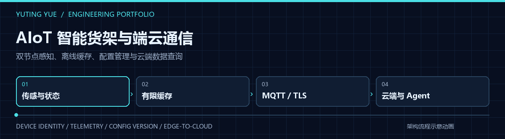
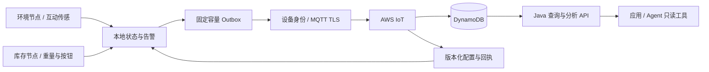

# AIoT 智能货架与端云通信系统



<sub>架构流程示意动画 · [静态版本](docs/assets/overview.png) · 动画不作为实测结果。</sub>

[返回技术作品集](https://github.com/KristenYue/KristenYue) · [机器人业务](https://github.com/KristenYue/telecom-network-incident-agent/blob/main/docs/ROBOT_DELIVERY.md) · [原生模型 SDK](https://github.com/KristenYue/edge-device-verification-lab/tree/main/inference_sdk) · [车辆 Agent](https://github.com/KristenYue/telecom-network-incident-agent/blob/main/docs/VEHICLE_ADAPTER.md)


**Arduino MKR WiFi 1010 · C++17 · MQTT / TLS · AWS IoT · DynamoDB · Java 17**

双节点分别感知环境与库存，把传感器输入转为本地状态、告警和遥测；网络恢复后有序补发，云端按消息身份处理重复与乱序，并通过查询 API 向应用和 Agent 提供最新设备信息。

**本项目承担的证据：端侧状态逻辑 + 通信恢复 + 云端数据一致性。** 机器人、汽车和工业设备岗位可重点看消息身份、配置版本、离线策略和设备工具接口；具体实现来自智能货架场景。

## 业务与架构



环境节点读取温湿度、气压、超声波与光线；库存节点读取重量、光线、声音与按钮。库存状态优先级为 **人工求助 → 遮挡 → 声音异常 → 无库存 → 低库存 → 正常**。

## 三个核心工程设计

| 问题 | 实现 | 工程价值 |
|---|---|---|
| **设备重启与重复上报怎样区分** | `deviceID:bootId:sequence` 消息身份；平台 `receivedAt` 与采样时间分别保存；同身份不同载荷单独分类 | 避免重启序列与旧会话混淆，重复、乱序、冲突不覆盖有效状态。[Telemetry v2](docs/TELEMETRY_V2.md) |
| **断网怎样继续采样并限制资源** | 固定容量 `FixedOutbox<4,96,512>`；满队列淘汰最旧项并计数；重连按 1 / 2 / 4 / 8 / 16 / 30 秒退避 | 离线策略、内存上限与数据取舍明确；计时使用差值处理回绕。[Outbox](firmware/core/include/smart_shelf/fixed_outbox.hpp) · [重连](firmware/core/include/smart_shelf/reconnect_backoff.hpp) |
| **乱序配置怎样避免参数回滚** | 单调 `configVersion`；参数及阈值关系校验后原子提交；成功 / 拒绝 / 状态回执 | 控制面和数据面均有可追溯身份。[配置版本](firmware/core/include/smart_shelf/config_version.hpp) |

硬件访问位于 `.ino` 适配层，共享状态、队列与配置逻辑位于 `firmware/core/`，可在宿主机验证，保留目标板独立编译入口。

## 量化结果：协议一致性

Windows / Python 3.12.9，固定种子 `20261102`，**50,000 条双节点合成遥测**：

| 分类 | 条数 | 系统行为 |
|---|---:|---|
| 正常数据 | **48,512** | 入库数量与 accepted 计数一致 |
| 重复消息 | **1,012** | 拦截重复 |
| 会话内乱序 | **13** | 不覆盖有效顺序 |
| 同身份载荷冲突 | **463** | 显式冲突分类 |
| 总计 | **50,000** | 四类计数完整闭合 |

[原始实验报告](iot-test-harness/docs/TEST_REPORT.md)。这是合成协议与持久化实验，不将脚本处理速度表述为 AWS 吞吐或实物采样能力。Windows x64 同型 Outbox 对象尺寸 **2,496 字节**，属于宿主机 ABI，目标板 SRAM 以编译报告为准。

## 与 AI 应用怎样连接

云端 `GET /api/shelves/{deviceId}/telemetry?limit=1` 提供最新遥测，[Agent Adapter](https://github.com/KristenYue/telecom-network-incident-agent/blob/main/src/telecom_incident_agent/shelf_adapter.py)校验设备身份、来源、状态及新鲜度。低库存可关联设备知识；旧遥测返回 `TELEMETRY_STALE`，避免将过去状态解释为当前故障。

## 运行与交付

固件核心：

```powershell
.\scripts\build_firmware_core.cmd
```

协议场景：

```bash
cd iot-test-harness
python -m pip install -e '.[test]'
python tools/run_stability.py --messages 50000
```

Java 服务：

```bash
cd cloud-service
mvn --batch-mode verify
```

AWS 部署需配置本机凭据、区域、IoT 数据端点与 API Token。固件从 `secrets.example.h` 创建本地 `secrets.h`；身份材料不进入公开仓库。目标板编译入口见 [CI](.github/workflows/ci.yml)，运行边界见 [固件交付说明](docs/FIRMWARE_VALIDATION.md)。

## 工程证据与 Bad Case

[状态机](firmware/core/include/smart_shelf/shelf2_controller.hpp) · [云端服务](cloud-service) · [工程日志](docs/ENGINEERING_LOG.md) · [Bad Case](docs/BAD_CASES.md)

关键问题包括：旧配置覆盖新配置、重启后序号重复、32 位计时回绕、满队列淘汰、未校时时间覆盖。MQTT QoS 1 交付与云端业务成功是两个环节；当前出队依据 MQTT 发送接口结果，业务 ACK 另有边界。真机弱网、传感器精度和目标板资源需独立记录，不与合成实验混算。


---

文档与结果口径：2026-11-19。功能以对应源码和运行记录为准；场景、执行环境和数据来源随结果一并标注。
