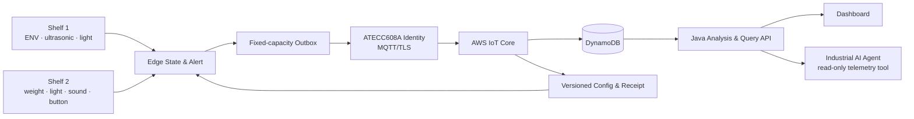

# AIoT Edge-to-Cloud — 智能设备与端云数据接入系统

[](https://github.com/KristenYue/smart-supermarket-shelf/actions/workflows/ci.yml)


## Project Overview

双节点 AIoT 端云系统。两台 Arduino MKR WiFi 1010 采集环境、顾客互动和库存信号，在边缘完成状态判断与现场告警，通过 ATECC608A 设备身份和 MQTT/TLS 接入 AWS IoT Core，云端提供存储、分析、查询和控制接口。

项目同时向 [Industrial AI Agent](https://github.com/KristenYue/telecom-network-incident-agent)提供只读设备遥测接口，使 Agent 能够查询最新设备状态、识别低库存或遥测失联，并将 IoT 数据与 Runbook 关联。

## Application Scenarios

| 节点/应用 | 输入 | 边缘行为 | 云端与 AI 应用 |
|---|---|---|---|
| `smart-shelf-01` | 温度、湿度、气压、超声波、光线 | 环境持续异常告警，统计靠近和商品互动 | 环境趋势、互动分析、设备状态查询 |
| `smart-shelf-02` | 重量、光线、声音、求助按钮 | 判断遮挡、碰撞、低库存、无库存和人工求助 | 库存预警、告警同步、Agent 诊断 |
| 设备配置 | MQTT `/config` | 校验版本、字段和阈值关系后原子提交 | 配置回执、当前版本查询、旧版本拒绝 |
| 断网恢复 | 本地采样与待发消息 | 固定容量 Outbox、重连退避、FIFO 补发 | 端云恢复后的顺序与丢弃计数 |

货架 2 的本地状态优先级：

```text
人工求助 > 遮挡异常 > 声音异常 > 无库存 > 低库存 > 正常
```

## Features & Real Demonstration

### 双节点 Telemetry v2

每条遥测使用 `{deviceID}:{bootId}:{sequence}` 作为 `messageId`：

- `deviceID` 隔离两台设备；
- `bootId` 区分重启前后的会话；
- `sequence` 保证同一会话内单调顺序；
- `timeSynchronized` 明确标记时间是否可信；
- AWS IoT Rule 生成 `receivedAt`，避免未校时消息覆盖正确数据。

### 50,000 条合成遥测实验

稳定性脚本使用固定种子生成 **50,000 条双设备合成遥测**，注入重复和乱序，核对接收、分类和持久化计数。该实验验证协议与数据处理逻辑，不等同于 50,000 条真实硬件遥测。

### Agent 只读设备工具

工业 Agent 通过既有接口读取：

```http
GET /api/shelves/{deviceId}/telemetry?limit=1
```

适配器校验设备 ID、来源、接收时间和状态取值。旧遥测不会被解释为当前设备故障，而是返回 `TELEMETRY_STALE`；低库存状态映射到对应设备 Runbook。

## System Architecture



## Core Implementation

| 模块 | 实现 |
|---|---|
| Edge Core | C++17 状态机、阈值约束、固定容量 `FixedOutbox<4,96,512>`，无动态内存 |
| Device Identity | 独立 Thing / Client ID / 证书，ATECC608A 私钥，BearSSL |
| Connectivity | MQTT QoS 1、1/2/4/8/16/30 秒重连退避、网络时钟检查 |
| Telemetry | boot-aware message ID、服务端接收时间、重复/冲突/乱序分类 |
| Configuration | `configVersion` 单调递增、完整参数校验、应用/拒绝/状态回执 |
| Cloud | AWS IoT Rule、DynamoDB、Java 17/Javalin 查询分析 API |
| Alert Extension | Spring Boot、MySQL、设备隔离与告警查询 |
| Agent Adapter | 固定上游、Token、时间新鲜度和只读工具边界 |

硬件访问保留在 `.ino` 适配层；状态机、配置版本、重连退避和 Outbox 位于 `firmware/core/`，可由标准 C++17 编译器在宿主机运行。

## Engineering Results

| 结果 | 说明 |
|---|---|
| 双设备独立状态与消息身份 | 避免重启、重复投递和跨设备串扰 |
| 固定容量离线队列 | 断网时缓存有限数量消息；满队列淘汰最旧项并记录计数 |
| 配置版本与回执 | 重复/旧版本不能回滚新配置，`GET` 返回当前生效版本 |
| 50,000 条合成遥测 | 固定种子下验证双节点、重复、乱序与持久化计数 |
| Agent 查询接入 | 最新遥测可作为工业 Agent 的设备状态工具 |
| 宿主机固件核心 | Windows/MSVC CTest 通过；同型 Outbox 对象在该 ABI 下为 2,496 字节 |

## Industry Applications

- **半导体与 AI 芯片：** 设备遥测、状态告警、配置管理和研发 Agent 数据接口。
- **智能汽车：** 端云状态同步、设备身份、车端配置版本和智能场景数据接入。
- **具身智能：** 机器人传感器节点、状态上报、云端查询与 Agent 设备工具。

这些是端云架构的迁移方向；当前实现是智能货架节点，不代表真实产线、车辆或机器人部署。

## Quick Start

### 固件核心

```powershell
.\scripts\build_firmware_core.cmd
```

### 遥测与协议

```powershell
cd iot-test-harness
python -m pip install -e ".[test]"
python -m pytest
python tools\run_stability.py --messages 50000
```

### Java 服务

```powershell
cd cloud-service
mvn --batch-mode verify
$env:AWS_REGION = "eu-west-2"
$env:AWS_PROFILE = "your-profile"
$env:AWS_IOT_DATA_ENDPOINT = "https://your-endpoint-ats.iot.eu-west-2.amazonaws.com"
$env:API_TOKEN = "a-long-random-token"
java -jar target\smart-shelf-cloud-service-1.0.0.jar
```

真实设备需要分别创建 AWS IoT Thing 和证书，将私钥写入各自 ATECC608A，并从 `secrets.example.h` 创建本地 `secrets.h`。私钥、证书、`.env` 和 `secrets.h` 不进入仓库。

## Evidence & Source Code

| 内容 | 入口 |
|---|---|
| 库存状态机 | [shelf2_controller.hpp](firmware/core/include/smart_shelf/shelf2_controller.hpp) |
| 固定 Outbox | [fixed_outbox.hpp](firmware/core/include/smart_shelf/fixed_outbox.hpp) |
| 重连退避 | [reconnect_backoff.hpp](firmware/core/include/smart_shelf/reconnect_backoff.hpp) |
| 配置版本 | [config_version.hpp](firmware/core/include/smart_shelf/config_version.hpp) |
| Telemetry v2 | [TELEMETRY_V2.md](docs/TELEMETRY_V2.md) |
| 固件与联网边界 | [FIRMWARE_VALIDATION.md](docs/FIRMWARE_VALIDATION.md) |
| 50,000 条实验报告 | [TEST_REPORT.md](iot-test-harness/docs/TEST_REPORT.md) |
| Agent 适配 | [Industrial AI Agent](https://github.com/KristenYue/telecom-network-incident-agent) |

## Validation & Limitations

- 两台 Arduino MKR WiFi 1010、传感器和 AWS IoT 架构来自项目设备设计；自动化回归主要在宿主机和合成遥测环境执行。
- 50,000 条数据是合成协议实验，不是线上设备采集或生产吞吐结论。
- `FixedOutbox` 的 2,496 字节是 Windows x64 ABI 对象尺寸，不是 Arduino 目标板 SRAM 报告。
- 目标板 Flash/SRAM 使用量应以 Arduino 编译输出为准；当前仓库尚未形成可公开的目标板构建报告，因此不填写推测数字。
- WiFiNINA、TLS 和 ArduinoMqttClient 仍可能阻塞单次调用；本地状态采样与现场告警并非完整实时操作系统任务。
- MQTT QoS 1 确认传输，不等于云端业务处理成功；当前没有独立的端云业务 ACK。
- Agent 回归使用合成云端响应，不声称持续在线的真实 AWS 设备联调。

详细测试、Bad Case 和硬件验收要求见 [FIRMWARE_VALIDATION.md](docs/FIRMWARE_VALIDATION.md)、[ENGINEERING_LOG.md](docs/ENGINEERING_LOG.md) 与 [BAD_CASES.md](docs/BAD_CASES.md)。

## License

[MIT](LICENSE)
