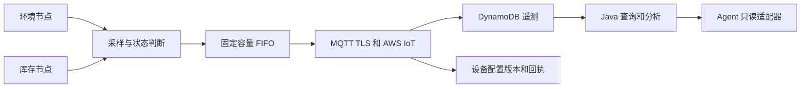

# 固件资源和离线队列验证

Windows x64 MSVC 14.43 宿主机运行 CTest 通过。固件同型 `FixedOutbox<4, 96, 512>` 对象在此 ABI 上为 2,496 字节。验证覆盖 FIFO、满队列淘汰、超长帧拒绝、拒绝后数据完整性、回绕与空队列边界。

Arduino Flash/SRAM 使用量应取目标板编译报告。实物弱网复验应分别采集正常与断网阶段采样时间戳，保存设备日志、MQTT 接收记录、补发与丢弃计数，并记录网络断开和恢复时间。宿主机对象尺寸及单元结果仅适用于上述环境。
# V2.0 双节点联网调度

核心模块：[库存状态机](../firmware/core/include/smart_shelf/shelf2_controller.hpp)、[固定队列](../firmware/core/include/smart_shelf/fixed_outbox.hpp)、[重连退避](../firmware/core/include/smart_shelf/reconnect_backoff.hpp)、[配置版本](../firmware/core/include/smart_shelf/config_version.hpp)、[云端入口](../cloud-service/src/main/java/com/smartshelf/App.java)。

面试准备：解释消息身份三元组、bootId 避免重启混淆、缓冲区满时如何取舍、为什么协作调度仍可能受 TLS 阻塞，以及 MQTT 成功与业务回执的关系。

基准提交 `0a2ebc2`。原先每次联网调用内最多重试 10 次 Wi-Fi 连接，并用 delay 等待网络时钟，断网时会长期占用采样循环。两个固件入口共用 `ReconnectBackoff`，本地采样和遥测在本轮联网操作之前执行。每轮至多尝试一次连接，失败后从尝试结束时开始按 1、2、4、8、16、30 秒退避，成功后重置。TLS 握手之前先检查网络时钟。

Bad Case：原重连条件使用绝对时间比较，计时回绕附近可能提前重试。宿主机测试覆盖 32 位回绕、退避上限、成功重置。Windows/MSVC Release 的 `scripts/build_firmware_core.cmd` 通过。

WiFiNINA、TLS、ArduinoMqttClient 仍可能阻塞单个调用，告警和部分传感器读取也仍有阻塞路径。固定队列出队基于当前 MQTT 发送接口返回值，端云业务处理没有独立 ACK。实际板卡采样抖动、Flash/SRAM 构建报告、本地 Broker 和真机弱网实验待验收。
## 配置版本与回执

双节点延用现有 `/config` 下行主题。版本字段 `configVersion` 接受 1 到 4294967295 的整数，只有高于当前版本且通过参数校验的配置才提交。重复或旧版本发布 `configuration_rejected`，应用成功发布 `configuration_updated`，发送 `GET` 可收到 `configuration_status`，均带当前生效版本。兼容启动默认版本下的旧格式配置。接受过带版本的配置后，旧格式不能覆盖已生效配置。

Bad Case：消息可能重复或乱序，旧参数会回滚新配置。宿主机已验证新版本、重复版本、乱序、无版本覆盖、溢出与小数。版本随当前会话存于 RAM，重启后回到默认配置和版本 0。回执通过现有 MQTT 事件通道发送，MQTT 发送与云端业务确认属于独立环节。
